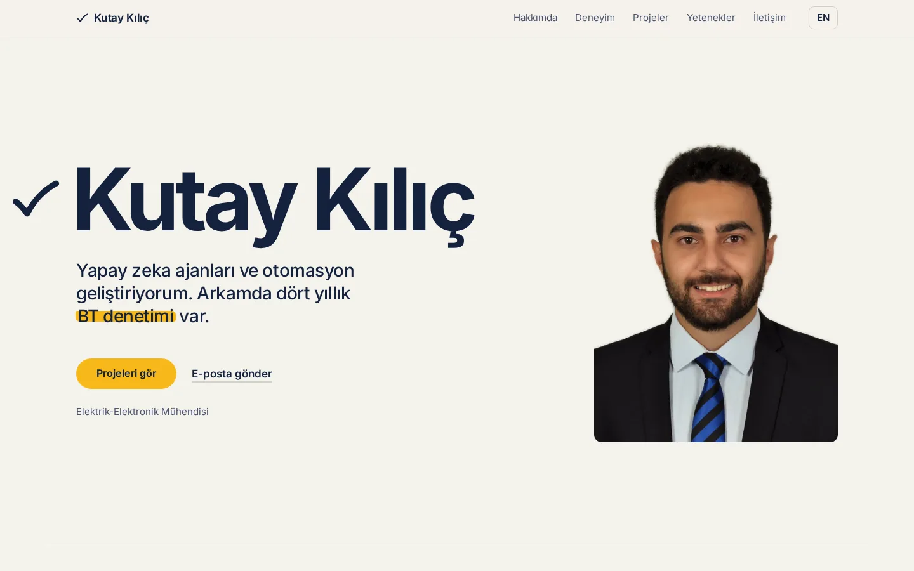

# Kutay Kılıç

Kişisel portfolyo sitem. GitHub Pages üzerinde yayında:
https://kutaykilicai.github.io/Kutay-portfolio.github.io/



## Yapı

Derleme adımı olmayan statik bir site: HTML, CSS ve biraz JavaScript. Kaydırma hareketi için üç küçük kütüphane `vendor/` klasöründe duruyor, CDN'e bağlı değil. `index.html` Türkçe, `en.html` İngilizce sürüm.

Metnin tamamı `tools/content.py` dosyasında, iki dil yan yana duruyor. Metni değiştirdikten sonra iki sayfayı yeniden üretmek için depo kökünde şunu çalıştırın:

```
python3 tools/build.py
```

Tasarım kararları (renkler, yazı, bölümler) `DESIGN.md` içinde. Önceki sürümler etiketlerde duruyor: `onceki-tasarim-20261123` (ilk yeniden tasarımdan önce), `krem-tasarim-20261123` (krem tema) ve `onceki-surum-20261124` (hareket katmanından önce). Renkler `style.css` içindeki `:root` jetonlarında. Jüri bölümündeki puanlar DeepSeek ve Gemini'den gelir, `tools/jury.json` dosyasında tutulur.

## Hareket katmanı

- Giriş: başlık kelime kelime bulanıklıktan netleşerek gelir, ardından metin ve düğmeler belirir, proje sayıları sıfırdan sayar. Bu kısım kütüphanesiz CSS ve JavaScript ile çalışır, portre ilk karede görünür kalır.
- Kaydırma: [Lenis](https://github.com/darkroomengineering/lenis) ile tekerlekte yumuşak kaydırma (dokunmatikte tarayıcının kendi kaydırması), [GSAP](https://gsap.com) ve ScrollTrigger ile girişten çıkarken portre ve metnin farklı hızda kayması, bölüm başlıklarında kelimelerin maskenin altından yükselmesi, iletişim başlığının kelime kelime netleşmesi.
- Bloklar görünüme girdikçe 80 ms arayla belirir. Girişteki ve altbilgideki düğmeler imleç yaklaşınca ona doğru hafifçe kayar.
- Metin, sayı ve mıknatıs efektleri [React Bits](https://reactbits.dev) bileşenlerinden (BlurText, SplitText, CountUp, Magnet) esinlenerek React'e geçmeden düz JavaScript ile yazıldı.
- Kütüphaneler sayfa yüklendikten sonra gelir, böylece ilk boyama onları beklemez. Yalnızca `transform` ve `opacity` anime edilir; telefonda ipek arka plan daha düşük çözünürlükte ve 30 karede çizilir.
- Sistemde hareketi azalt ayarı açıksa bu katmanın hiçbiri çalışmaz, sayfa sade ve hareketsiz açılır.

## Kaynaklar

- Yazı tipi: cihazın sistem yazı tipi (Segoe UI Variable, SF Pro). Bulunmadığında `fonts/` klasöründeki Inter kullanılır; Inter SIL Open Font License 1.1 ile lisanslıdır.
- Proje ekran görüntüleri kendi depolarımdan alındı: agac-boyutu, bolmeler, robokopya, hizli-indir, kuti-dock ve vault-breach.
- GSAP 3.15 ve ScrollTrigger: GreenSock standart lisansı (ücretsiz, https://gsap.com/standard-license). Lenis 1.3: MIT, lisans metni `vendor/LICENSE-lenis.txt`.
- Logo: KK monogramı (`favicon.svg`, `img/logo-kk.svg`), bu site için çizildi.

## Lisans

MIT
